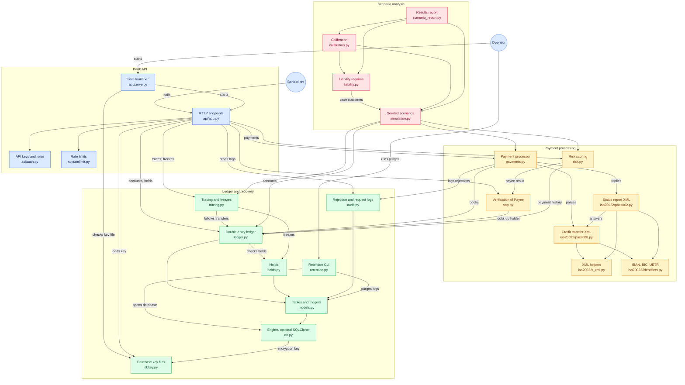

# Echtzeit

A scam-liability lab for instant payments. Work in progress, version 0.1.

Echtzeit simulates SEPA Instant payments end to end. It covers a double-entry ledger,
ISO 20022 messages, payee-name checks, a transparent risk score, money mules, tracing and
freezing of stolen money. On top of that it shows who carries the loss under different
reimbursement regimes. An authenticated HTTP API lets simulated banks use it, each limited
to its own customers. All money, people and banks are fictional. Nothing connects to a bank,
a payment scheme or real customer data.

## Results in short

Seed 7 in detail, plus a spread over seeds 1 to 10:
[docs/results/scenarios-seed-7.md](docs/results/scenarios-seed-7.md). The file is generated by
code, and no number in it is typed by hand. Over the ten seeds (minimum / median / maximum):

| | No scoring | Sending bank scores | Plus freeze of outgoing money | Plus screening of incoming payments |
|---|---|---|---|---|
| Scam money lost, recovery along the traced path | 49.3% / 63.0% / 82.7% | 6.9% / 17.8% / 32.5% | 0.0% / 6.5% / 18.7% | 0.0% / 0.8% / 10.4% |
| Normal payments warned or blocked | 0% | 3.1% / 5.3% / 7.4% | 3.1% / 5.3% / 7.4% | 3.1% / 5.3% / 7.4% |
| Normal payments held back by the receiving bank | 0% | 0% | 0% | 0.6% / 0.7% / 0.8% |
| Victims' share under the UK rules | 2.4% / 16.9% / 25.9% | 0.3% / 3.8% / 11.4% | 0.0% / 0.4% / 4.0% | 0.0% / 0.1% / 1.0% |
| Victims' share with no refund rule | 52.2% / 75.0% / 87.5% | 6.9% / 17.8% / 32.5% | 0.0% / 6.5% / 18.7% | 0.0% / 0.9% / 10.4% |
| Victims' share under Brazil's MED | 49.3% / 63.0% / 82.7% | 6.9% / 17.8% / 32.5% | 0.0% / 6.5% / 18.7% | 0.0% / 0.8% / 10.4% |
| Victims' share under the EU Council text | 0% | 0% | 0% | 0.0% / 0.0% / 1.0% |

The columns are the policies `NONE`, `SENDER_ONLY`, `SENDER_AND_RECEIVER` and `FULL_CHAIN`.
Each step adds checks, and each step's cost shows up in normal payments: about one in twenty is
warned once the sending bank scores, and screening incoming payments also holds back the
legitimate large first payments to newly opened accounts.

The UK rules move most of the loss to the banks. Brazil's MED makes no bank pay, but when
nothing is scored its recovery along the traced path leaves victims with a smaller share than
the no-refund baseline, which recovers only from the first receiving account.

Under the EU Payment Services Regulation as the Council adopted it at first reading (not in
force), the victim's bank carries every loss unless both banks monitored the payment
(art. 87(3)). Only `FULL_CHAIN` has the receiving bank screen incoming payments; there the
rules on suspicion (art. 68) and impersonation (art. 60) decide instead.

Checked against real, published figures (details in the results file):

- At the EU fraud rate of about one fraudulent credit transfer in 50,000 (EBA and ECB, 2025),
  the warning rate of sending-side scoring on seed 7 would mean about 3,700 flagged normal
  payments for each scam payment. The simulation's own scam share, about 3%, hides that cost.
- With scam amounts around the EBA-ECB average of EUR 2,155 instead of the default amounts,
  sending-side scoring loses more (median 25.4% of scam money, against 17.8%), because the
  amount rules fire less often. Screening incoming payments still keeps the median loss at
  0.3%.
- The simulated UK regime reimburses 97% of the money in covered claims, against 88% in the
  PSR's dashboard. Treating an ignored warning as gross negligence would reject most covered
  claims in the scored policies, against 3% in reality.

These numbers are not evidence about real fraud. The same author wrote the scenarios and the
risk rules, so the results are circular by construction. Every probability, delay and amount
is an assumption, and the results file lists all of them.

## Repository layout

| Path | What it holds |
|---|---|
| `src/echtzeit/` | The library: ledger, holds, tracing, payment processing, risk scoring, simulation, liability regimes, calibration, results report, retention and database setup. |
| `src/echtzeit/iso20022/` | Building and parsing `pacs.008` and `pacs.002` messages, and IBAN, BIC and UETR checks. |
| `src/echtzeit/api/` | The HTTP API: endpoints, API keys and roles, rate limits, and the launcher with its TLS and key checks. |
| `tests/` | The pytest suite, one file per module area, plus shared fixtures (`conftest.py`, `helpers.py`). |
| `docs/design/` | Design notes: holds and tracing, scenarios and scoring, liability regimes, threat model. |
| `docs/results/` | The generated results for seed 7. Produced by `echtzeit.scenario_report`; not edited by hand. |
| `.github/workflows/` | CI: lint, tests on Python 3.12 to 3.14 (plain and encrypted database), `bandit` and `pip-audit`. |
| `pyproject.toml` | Package metadata, dependencies and extras (`api`, `encryption`, `dev`), pytest and ruff settings. |
| `LICENSE`, `NOTICE` | Apache License 2.0 and the copyright notice. |
| `.gitignore` | Keeps environments, databases, key files and certificates out of git. |

GitHub shows the last commit message next to each path, not a description; this table is the
description.

## Architecture

Modules in `src/echtzeit/` and how they depend on each other. An arrow points from a module to
one it uses. `errors.py` is left out, because almost every module imports it.



The first version of this diagram was generated with [GitDiagram](https://gitdiagram.com) and
then checked against the imports in the code. The check added `dbkey.py`, the operator, the
retention CLI's own database connection, and the `vop.py` → `ledger.py` and `pacs002.py` →
`pacs008.py` dependencies.

## What is implemented

| Module | What it does | Design and limits |
|---|---|---|
| `ledger`, `models`, `db` | Accounts in integer cents. An append-only double-entry ledger. Atomic, idempotent transfers with a booking time. Holds. An invariant check that rebuilds every balance from the ledger. | below |
| `iso20022` | `pacs.008.001.08` credit transfer and `pacs.002.001.10` status report for SEPA Instant: build, parse and rule checks from the EPC Inter-PSP guidelines. IBAN, BIC and UETR helpers. | below |
| `payments` | Turns a `pacs.008` into a ledger transfer and answers with a `pacs.002`. | below |
| `audit` | Append-only log of every rejected payment message. | below |
| `holds`, `tracing` | Holds stop money on an account. Tracing follows a payment through later transfers. Freezing holds what is still there. | [holds-and-tracing.md](docs/design/holds-and-tracing.md) |
| `vop`, `risk` | Verification of Payee with the four EPC outcomes, a rule-based risk score for outgoing payments and an incoming screen for the payee's bank. Every result lists the rules that fired. | [scenarios-and-scoring.md](docs/design/scenarios-and-scoring.md) |
| `simulation`, `scenario_report` | A seeded synthetic population with normal payments and three scam patterns from the EPC fraud report. Four policies compared on the same world. | [scenarios-and-scoring.md](docs/design/scenarios-and-scoring.md) |
| `calibration` | Real, sourced reference figures (EBA-ECB, PSR) and the base-rate conversion. | [scenarios-and-scoring.md](docs/design/scenarios-and-scoring.md) |
| `liability` | Shares each loss between the victim, the sending bank and the receiving bank under the UK rules, the provisional EU rules, Brazil's MED and a no-refund baseline. | [liability.md](docs/design/liability.md) |
| `api` | HTTP API with expiring API keys, roles (bank, auditor, admin), per-bank authorization, rate and size limits, a per-client request log and a launcher that requires TLS off localhost. | [threat-model.md](docs/design/threat-model.md) |

### Ledger

- A transfer writes a debit and a credit that sum to zero, in one database transaction. A
  failure rolls back everything.
- An idempotency key identifies one request. The same key with the same content returns the
  original transfer. The same key with different content is refused.
- Database triggers block updates and deletes on transfers, ledger entries, holds, hold
  releases and the audit log.
- Payments can spend only the balance minus active holds. Database checks forbid a negative
  customer balance and more held than the balance.

### Payment processing

Checks run in this order, and the first failure decides the `pacs.002` reply. Unknown IBAN
gives `AC01`. A BIC that does not match the account gives `RC01`. The same key with different
content, or a UETR already used, gives `AM05`. A message older than 10 seconds gives `AB05`.
A payment the payee's bank holds back after screening gives `RR04`. Insufficient funds gives
`MS03`. The EPC list has codes for neither case, so both mappings are this project's choice.

- A repeated message is answered as accepted and moves money once. This holds even when the
  retry arrives after the 10-second limit, so a completed payment is never reported as timed
  out.
- The idempotency key is the originator BIC plus the `TxId`, because the EPC guidelines make
  `TxId` unique per originator PSP.
- Every rejection is written to the audit log before the reply. If that write fails, no reply
  is sent. No money has moved at that point, so the originator can retry.
- XML input is parsed with `defusedxml`.

### HTTP API

Every endpoint except `GET /v1/health` needs `Authorization: Bearer <key>`.

| Endpoint | Who may call it |
|---|---|
| `POST /v1/accounts`, `POST /v1/accounts/{iban}/deposits` | admin |
| `GET /v1/accounts/{iban}` | the account's bank, auditor, admin |
| `POST /v1/vop` | any bank |
| `POST /v1/risk/assessments` | the debtor account's bank |
| `POST /v1/payments` (body: `pacs.008` XML, reply: `pacs.002` XML) | the debtor agent's bank |
| `GET /v1/payments/{uetr}/trace` | the payment's sending or receiving bank, auditor |
| `POST /v1/payments/{uetr}/freeze` | any bank, holding only its own accounts |
| `POST /v1/accounts/{iban}/holds`, `POST /v1/holds/{id}/release` | the account's bank |
| `GET /v1/accounts/{iban}/holds` | the account's bank, auditor |
| `GET /v1/audit/rejections` | auditor (all), banks (only rejections that involve them) |
| `GET /v1/audit/requests` | auditor |
| `GET /v1/invariants` | auditor, admin |

- A bank's request for another bank's account gets the same "not found" answer as an IBAN
  that does not exist.
- Traces show other banks' accounts only as BIC and amounts.
- Who placed or released a hold is taken from the key, never from the request.
- Errors use RFC 9457 problem details and never include internals or submitted values.
- Keys expire (90 days by default). Rotation means creating a second key for the same client
  and revoking the old one. The server picks up a changed key file without a restart.
- Every call except the health check is recorded with client, key id, route template, status
  and duration. Bodies, keys and IBANs are not recorded.

## Limits

Ledger and database:

- The database is SQLite, which allows one writer at a time. The concurrency tests show the
  ledger rules hold when requests overlap. They do not show how the code behaves with
  PostgreSQL row locks, and tracing relies on writers being serialized. Reads also start with
  `BEGIN IMMEDIATE`, so a long trace makes writers wait.
- The append-only and retention triggers are created with their tables. A database whose
  triggers were dropped does not get them back from `init_db`. Changes to a retention period
  are not logged; only purges are.
- There are no migrations. Delete any database file created by an earlier version. A database
  created before the retention tool refuses every purge.
- The audit log and the request log can be purged after a period the operator sets. They have
  no tamper-evident chaining, and a database administrator can drop the triggers. Rows hold
  IBANs and amounts, which would be personal data in a real deployment. The ledger, transfers
  and holds hold the same kind of data and are never purged.
- Encryption at rest is optional and needs a key file. There is no key rotation, and losing
  the key file loses the database.
- A direct ledger call that fails (for example in a test) leaves no record. Rejected payment
  messages are in the audit log.

ISO 20022 and processing:

- The messages cover one credit transfer per message, in EUR only, with IBAN and BIC
  identification and unstructured remittance text. Amounts must be plain ASCII digits with at
  most two fraction digits (no sign, exponent or leading point), which is stricter than the
  `xs:decimal` type in the schema. Postal addresses, party identifiers, structured remittance,
  purpose codes and intermediary agents are not implemented. The EPC character-set rule is not
  enforced. The messages are not certified and are not exchanged
  with any real scheme.
- `pacs.002` accepts only the rejection codes the EPC lists for a message to the originator
  PSP. That list has no "suspected fraud" code, and it has no inter-PSP code for insufficient
  funds. Using `MS03` for the latter is this project's choice.
- The processor does not compare the creditor name with the account holder. Verification of
  Payee runs on the sending side before the message is built, as in the EPC scheme.
- The 10-second limit is measured against the processor's clock, in both directions: a message
  dated more than 10 seconds in the future is refused like a late one (`AB05`). Network delay
  and clock skew are not modelled.
- IBANs pass if they have the general format and the mod-97 check digits. The length per
  country is checked only for Germany (22 characters), the country of every generated IBAN.
- The payee-name comparison drops accents on Latin letters and folds ø, ł, đ, æ, œ and þ. Marks
  that other scripts need, such as Devanagari vowel signs, are kept. Transliteration between
  scripts is not attempted.
- The ISO XSD files are not stored here. Four tests validate output against them and are
  skipped when the files are missing. To run them, download `pacs.008.001.08.xsd` and
  `pacs.002.001.10.xsd` from the ISO 20022 message definitions (https://www.iso20022.org) and
  run `ECHTZEIT_XSD_DIR=/path/to/folder pytest`. CI does not run these four tests.

Holds and tracing:

- Mixed money cannot be attributed exactly. Two greedy rules give two estimates. They usually
  bracket the result but are not guaranteed bounds, and they are not legal tracing rules
  (example in [holds-and-tracing.md](docs/design/holds-and-tracing.md)).
- Direct Python calls to the ledger do not check who places or releases a hold; `placed_by`
  is a free-text label there. The HTTP API takes it from the key and lets a bank hold only its
  own accounts.
- Held money is only stopped. Returning it to the victim is not implemented.
- In the scenarios, the time until a freeze is the victim's reporting delay, which is an
  assumption. The time a bank needs to act on a report is not modelled.

Scenarios, scoring and liability:

- The same author wrote the scenarios and the rules. The points and thresholds are not
  calibrated. The Verification of Payee name comparison and its threshold are this project's
  choice, because the EPC leaves matching to each PSP.
- Cash withdrawals are not scored, because they are not instant credit transfers.
- Assessment times come from one machine with SQLite and exclude network and messaging.
- The UK and Brazilian regimes are applied as what-ifs to euro payments, the UK one at a fixed
  ECB exchange rate. The EU regime follows the Council's position at first reading, which is
  not in force and may still change. Its "objectively justified reasons to suspect fraud" are
  not defined in numbers, so mapping them to risk rules is this project's interpretation.
  Only `BR_MED` counts recovery along the traced path. The other regimes count only the first
  receiving account, which understates what cooperating banks may recover.
- The victim and the first mule are given banks independently, so about a third of executed
  scam payments are between two accounts of the same bank (78 of 240 with policy `NONE`, seeds 1
  to 10).
  The liability tables still split such a case between a sending and a receiving role, so
  "sending PSP" and "receiving PSP" are roles, not necessarily two institutions. Claim deadlines, vulnerability assessments
  and several other rules are not modelled. The list is in
  [liability.md](docs/design/liability.md).

HTTP API:

- TLS needs a certificate you provide. The minimum TLS 1.2 comes from Python's defaults,
  checked on 25 November 2026, and is not set by the code.
- Rate limits are in memory and cover one server process. Failed-login buckets are kept for
  at most 10,000 sources at a time; buckets that have refilled are dropped first.
- Requests without a valid key are written to the request log too, so a flood of them grows
  the database until a retention purge removes the rows.
- The admin role gets 403 on a trace of an existing payment and 404 on a missing one, so it
  can tell whether a UETR exists. UETRs are random, so this reveals little.
- The request log is written after each response. If that write fails, the server log
  reports it, but the call is not refused.
- The full list, with the test behind each mitigation, is in
  [threat-model.md](docs/design/threat-model.md).

## Run

Run every command from the project folder. Python 3.12 or later is needed; check with
`python3 --version`. The `python3` that ships with macOS is 3.9 and too old, so install a newer
one (for example `brew install python`). Outside a virtual environment, macOS and many Linux
systems have only `python3`, not `python`; once the environment is active, `python` and `pip`
point to it. On macOS with iCloud Drive, create the environment as described in
[macOS with iCloud Drive](#macos-with-icloud-drive) instead of the first `python3` line.

```bash
git clone https://github.com/flango2023/Echtzeit.git
cd Echtzeit
python3 -m venv .venv
source .venv/bin/activate
pip install -e ".[dev]"
pytest
python -m echtzeit.scenario_report --seed 7 --spread-seeds 10 --out /tmp/scenarios-seed-7.md
```

`pytest` should end with `321 passed, 4 skipped`; the four skipped tests need the ISO XSD
files (see Limits). The report command writes to `/tmp` so the committed results in
`docs/results/` stay as they are; only its timing lines should differ from them.

The report took about 4 minutes on the machine used here (234 s on 26 November 2026). CI
runs `ruff` and `pytest` on Python 3.12, 3.13 and 3.14, runs the tests a second time on an
encrypted database, and runs `bandit` and `pip-audit`, for every push. The GitHub actions are
pinned to commit hashes; the Python tools are not pinned.

Run the API locally:

```bash
python -m echtzeit.api.auth new --client admin --role admin --keys keys.json
python -m echtzeit.api.auth new --client bank-a --role psp --bic ECHTDEFF --keys keys.json
python -m echtzeit.api.serve --keys keys.json --db sqlite:///echtzeit.db
```

Each `new` command prints its key once on standard output and its key id on standard error.
`keys.json` stores only hashes, is created with mode 600 and must stay out of version control.
The server refuses to start without it, or if other users can read it. To rotate, create a
new key for the same client, switch over, then remove the old one:

```bash
python -m echtzeit.api.auth list --keys keys.json
python -m echtzeit.api.auth revoke --key-id <key id> --keys keys.json
```

The launcher listens on 127.0.0.1:8000. To listen on another address it requires
`--tls-cert` and `--tls-key`, and the key file must be readable only by its owner. It also
requires an encrypted database.

Encrypt the database at rest (SQLCipher, installed with the `encryption` extra, which `dev`
includes):

```bash
python -m echtzeit.dbkey new db.key
python -m echtzeit.api.serve --keys keys.json --db sqlite:///echtzeit.db --db-key-file db.key
```

The key file holds a random 256-bit key, is created with mode 600 and must stay out of version
control. Keep a copy apart from the database: without it the data cannot be read. The key is
never put in the database URL. A wrong key is refused when the server starts, and an existing
unencrypted database cannot be opened with a key. `ECHTZEIT_TEST_ENCRYPTED=1 pytest` runs every
ledger test again on an encrypted database.

Keep the logs for a limited time. Only `rejected_payments` and `api_requests` can be purged,
and only after a period you set (at least 30 days). Without a period nothing is deleted:

```bash
python -m echtzeit.retention --db sqlite:///echtzeit.db set api_requests 90
python -m echtzeit.retention --db sqlite:///echtzeit.db purge --dry-run
python -m echtzeit.retention --db sqlite:///echtzeit.db purge
python -m echtzeit.retention --db sqlite:///echtzeit.db show
```

The 90 days above is an example, not advice. Add `--db-key-file db.key` for an encrypted
database. Each purge is recorded in `retention_runs`, which cannot be changed or deleted.

### macOS with iCloud Drive

If Desktop and Documents sync to iCloud Drive, iCloud sets the hidden flag on files inside
dot-folders such as `.venv`, within about a minute. Python 3.13 and later skip hidden `.pth`
files, so `import echtzeit` stops working after `pip install -e .`. This was reproduced here:
files in `.venv` became hidden, files in the project root and outside iCloud did not, and
files in a folder ending in `.nosync`, which iCloud does not sync, stayed visible. Keep the
environment in a `.nosync` folder and link `.venv` to it:

```bash
python3 -m venv .venv.nosync
ln -s .venv.nosync .venv
source .venv/bin/activate
```

Both names are in `.gitignore`. The tests run either way, because `pyproject.toml` sets the
pytest `pythonpath`.

## Security

Checked:

- XML input is parsed with `defusedxml`. Tests confirm that an entity-expansion payload and an
  external-entity payload are refused.
- `bandit` reports no issues on `src/`. Three kinds of finding are marked in the code with the
  reason. The first is the `xml.etree` import, because those modules only build documents and
  never parse input. The second is the seeded random generator in the simulation, which is
  needed for reproducible runs. Payment identifiers come from `uuid4`. The third is SQL built
  from table and column names, which come from constants in the code, never from input.
- `pip-audit` found no known vulnerabilities in the installed dependencies on 25 November
  2026. This is a point-in-time result; CI repeats `bandit` and `pip-audit` on every push.
- The API authenticates every call, enforces roles and per-bank scope, limits rates and body
  sizes, refuses unknown request fields and hides internals in errors. A threat model lists
  each threat with its mitigation and the test that shows it:
  [threat-model.md](docs/design/threat-model.md).
- With a key file, the database and its write-ahead log are encrypted with SQLCipher, and the
  launcher requires this on any address other than loopback. Tests check that the file on disk
  contains neither the SQLite header nor an IBAN, and that a wrong key is refused.
- The audit and request logs can be purged after an operator-set period, following the GDPR's
  storage-limitation principle
  ([Regulation (EU) 2016/679](https://eur-lex.europa.eu/eli/reg/2016/679/oj), art. 5(1)(e)).
  Database triggers refuse to delete younger rows, and refuse every delete when no period is
  set.
- No credentials, tokens or real personal data are stored in the repository.

Not done yet:

- Certificates, key storage outside a file (for API keys and the database key) and
  multi-process rate limits are left to the deployment.
- Purges do not run on a schedule, and the database key cannot be rotated.
- Message-level protection such as signing is not implemented.

Do not expose this code to a network or use it with real money or real customer data.

## Ethics

- All accounts, names, IBANs, BICs and amounts are fictional. IBANs and BICs have valid check
  digits or format but belong to no real bank. Nobody has verified that no real institution
  uses the placeholder values.
- The scam scenarios are synthetic. Results from synthetic data say nothing about how well a
  method would detect real fraud, and the project does not claim they do.
- The scenarios describe fraud patterns at the level already published by the EPC. The risk
  rules use generic, widely published signals. The project contains no tooling that helps
  evade detection.

## Sources

This project is original code. These documents were read to implement the rules. No text or
code from them is copied into the repository.

- EPC, *SEPA Instant Credit Transfer Inter-PSP Implementation Guidelines 2025 Version 1.0*
  (EPC122-16): message elements, mandatory fields and rejection reason codes.
- ISO 20022 message definitions `pacs.008.001.08` and `pacs.002.001.10`: element order and data
  types. The XSD files are not redistributed here.
- Regulation (EU) 2024/886 (Instant Payments Regulation): the 10-second limit and Verification
  of Payee context.
- EPC, *2025 Payments Threats and Fraud Trends Report* (EPC162-24, version 2.0, 19 November
  2025): safe-account fraud (section 2, page 17), IBAN manipulation at the invoicing stage
  (executive summary, page 7) and one or two levels of money mules (section 3.1.7.1, page 44).
- EPC FAQ *Clarifications about the provision of VOP-services for bulk files*: the four
  Verification of Payee outcomes.
- Payment Systems Regulator: the consumer page on APP fraud reimbursement protections, policy
  statement PS24/7, the APP scams overview and the policy clarifications page, for the UK
  regime.
- Council of the EU: position at first reading on the Payment Services Regulation (document
  8543/26, 21 October 2026), the final compromise text (8221/26) and the press release of 27
  November 2025, for the EU regime (art. 27, 50, 60, 68, 73 and 87).
- ECB euro foreign exchange reference rate GBP/EUR of 24 November 2026, for converting the UK
  cap and excess.
- EBA and ECB, 2025 Report on payment fraud, and the PSR's APP scams reimbursement dashboard
  for Q1 2026, for the reference figures in `echtzeit/calibration.py`.
- Banco Central do Brasil: Resolução BCB nº 493 of 28 August 2025 and the Manual Operacional
  do DICT, version 8.5, section 20, for the MED funds recovery.

For local schema validation the XSD files were downloaded from public GitHub repositories
(`sebastienrousseau/pacs008` and `prog-nov/iso20022-messages-for-go`). Only the schema files
were used, for checking output. No source code from those projects is used. Download the
official files from iso20022.org to reproduce the checks.

## License

Copyright 2026 Richard Schmitz. Licensed under the Apache License 2.0; see `LICENSE` and
`NOTICE`. Redistributions must keep the `NOTICE` file.
